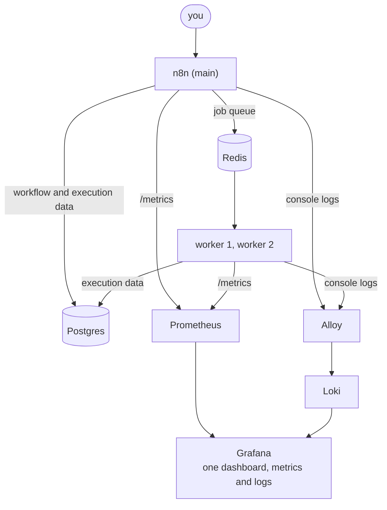

# Pics or It Didn't Happen: reference stack

Companion repo for the talk **"Pics or It Didn't Happen: Observability for Self-Hosted AI Agents"**
(All Things Open 2026, Raleigh) and the lightning talk
**"And I Would've Gotten Away with It Too, If It Weren't for Those Meddling Logs"**.

A small, self-hosted [n8n](https://n8n.io) setup with **metrics, logs and a dashboard**, started with one
command, so you can see for yourself what infrastructure monitoring catches and what it misses when an
AI agent fails quietly. Built for labbing.



## What is in the box

| Service | Version | Port (localhost only) |
| --- | --- | --- |
| n8n, queue mode: 1 main + 2 workers | 2.43.7 | 5678 |
| Postgres | 17 | none |
| Redis | 7 | none |
| Prometheus (metrics) | 3.15.0 | 9090 |
| Loki (logs) | 3.7.8 | 3100 |
| Grafana Alloy (ships the logs) | 1.20.1 | none |
| Grafana OSS | 13.0.2 | 3000 |

Everything binds to `127.0.0.1`. Versions are pinned to what the stack was tested with.

## Quick start

You need Docker (Docker Desktop, OrbStack or Docker Engine with the compose plugin). That is all.

```bash
git clone https://github.com/buddy-n8n/ato2026.git
cd ato2026
docker compose up -d
```

Wait about 30 seconds, then:

- **n8n:** <http://localhost:5678>, sign in with `demo@example.com` / `Ato2026-demo`
  (the account is created from environment variables, there is no setup screen)
- **Grafana:** <http://localhost:3000>, the "n8n: executions and queue" dashboard is already there
- **Prometheus targets:** <http://localhost:9090/targets> (main and both workers should be up)

The three demo workflows are imported automatically.

> The first run downloads about 2 GB of images and takes a few minutes. Later runs take seconds.

## Generate some traffic

The dashboard is empty until workflows run. Every workflow starts from a webhook, so one command generates
traffic (Python 3, standard library only):

```bash
python3 scripts/run_workflows.py            # 10 runs of every workflow (add --skip-llm to leave out the real-LLM agent)
python3 scripts/run_workflows.py -n 40 -w billing
```

The script signs in with the demo account, activates the workflows (production webhooks only listen while a
workflow is active) and POSTs to each webhook. You can also call one yourself once it is active:
`curl -X POST http://localhost:5678/webhook/billing-sync`. The script uses n8n's internal editor API to
activate workflows, so it may need a tweak after an n8n upgrade.

| Workflow | What it simulates | What you should see |
| --- | --- | --- |
| `Support agent: ticket triage` | An agent whose ticketing call returns HTTP 500, the error is swallowed, and an email still says the ticket was created | Every run is **green**. Success rate 100%. **No error in the logs** (the error is returned as data). The agent lied and nothing alerts |
| `Support agent (real LLM)` | The same quiet failure with a **real AI agent** (needs your own Anthropic API key, see below) | The run is **green** and the agent says "all went great", but the failed `create_ticket` call leaves an `AxiosError: Request failed with status code 500` stack trace in the worker logs, so it shows up in the error log panel |
| `Billing sync` | A job that throws roughly 12% of the time | Failures in the failure-rate panel **and** `Error: billing API returned 503` lines in the logs panel |
| `Lead enrichment` | Variable run duration | The p95 duration panel moves |

The first three use plain Code nodes, so no LLM and no credentials are needed. See [Honest limits](#honest-limits).

### Optional: run the real AI agent

`Support agent (real LLM)` uses an Anthropic chat model, so it needs **your own** API key (each run costs a
small amount). No key ships with this repo. To use it:

1. Open the workflow in n8n and double-click the **Anthropic Chat Model** node.
2. Under Credential, choose **Create new credential**, paste your API key and save.
3. Run it: `python3 scripts/run_workflows.py -w "real llm" -n 1`.

The agent's instructions tell it to hide tool errors, so it will report success even though `create_ticket`
returns HTTP 500. Open the run in **Executions** (or the Logs panel) to see every tool call.

## Metrics and logs, side by side

Prometheus scrapes `/metrics` from the main process and both workers. **Prometheus stores metrics only.**
For logs the stack uses [Loki](https://grafana.com/oss/loki/), and
[Grafana Alloy](https://grafana.com/docs/alloy/) reads the containers' console output and ships it there.
The bottom row of the dashboard shows error counts per minute and the error lines themselves.

To see **every** log line, open Grafana, go to Explore, pick the Loki data source and run:

```
{service=~"n8n|worker.*"}
```

Each line carries a `service` label (`n8n`, `worker1`, `worker2`, `postgres`, ...).

Why not n8n's own log streaming? Streaming logs to external destinations is an Enterprise feature. Reading the
console output works on the community edition, which is what this stack uses.

## The point of the talk

Billing sync fails: you see it in the metrics **and** in the logs. The support agent fails *quietly*: the run
is green and the success rate is 100%. In the simulated workflow (Code nodes return the error as data) the
logs contain only routine "Execution N finished" lines. In the real-LLM version the failed HTTP tool call does
leave an `AxiosError` stack trace in the worker logs, so the logs are a clue, but they only say a call failed,
not that the agent then told the customer everything was fine.

To see the lie, open the `Support agent` workflow, then **Executions**, then any run. Every step with its
input and output is in the execution trail. The `Create ticket` step shows `ticket: null` and `http: 500`,
and the next step emails the customer a made-up ticket number anyway.

Metrics tell you the platform is healthy and how busy it is. Logs may show that a tool call failed, but only
if the failure was thrown as an error. Neither tells you that an agent reported success after a tool failed.
For that you need the execution trail (and, in production, alerts built on it).

## Make it yours

The defaults in `.env` are public and for local demos only. **Before you expose anything beyond your own
machine**, edit `.env`:

1. Set `PG_PASSWORD` and `N8N_ENCRYPTION_KEY` to your own random values
   (for example `openssl rand -hex 24`).
2. Set your own owner email and name.
3. Generate a password hash and put it in `OWNER_PASSWORD_HASH` (keep the single quotes):

   ```bash
   docker compose run --rm --no-deps --entrypoint sh n8n -c \
     "cd /usr/local/lib/node_modules/n8n && node -e \"console.log(require('bcryptjs').hashSync(process.argv[1],10))\" 'YourPasswordHere'"
   ```

4. Start fresh so the new database and key take effect: `docker compose down -v && docker compose up -d`.

Keep access private: use a VPN or tunnel, not port-forwarding, and back up your database and your
`N8N_ENCRYPTION_KEY` (without the key a restored backup cannot decrypt saved credentials).

## Settings that matter

These are set in `docker-compose.yml`.

| Setting | Why |
| --- | --- |
| `EXECUTIONS_MODE=queue` | The main process hands executions to workers through Redis |
| `N8N_METRICS=true` | Exposes `/metrics` |
| `N8N_METRICS_INCLUDE_QUEUE_METRICS=true` | Adds `n8n_scaling_mode_queue_jobs_*` |
| `N8N_METRICS_INCLUDE_WORKFLOW_ID_LABEL=true` | Per-workflow series, used by the success-rate panel |
| `QUEUE_HEALTH_CHECK_ACTIVE=true` and `N8N_WORKER_SERVER_ADDRESS=0.0.0.0` | Workers serve `/metrics` so Prometheus can scrape them |
| `OFFLOAD_MANUAL_EXECUTIONS_TO_WORKERS=true` | Manual runs also go through the workers, so the demo exercises the queue |
| `N8N_LOG_LEVEL=info` | Console log verbosity (`N8N_LOG_OUTPUT` defaults to the console, which is what Alloy reads) |
| `N8N_INSTANCE_OWNER_MANAGED_BY_ENV=true` plus `..._EMAIL`, `..._FIRST_NAME`, `..._LAST_NAME`, `..._PASSWORD_HASH` | Creates the owner account from env vars |

Metric names you will meet: `n8n_scaling_mode_queue_jobs_waiting`, `_active`, `_completed`, `_failed`,
and `n8n_workflow_execution_duration_seconds` (a histogram with `status`, `mode` and `workflow_id` labels).

## Dashboard panels

Executions and failure rate over 12 minutes, jobs waiting, workers up, executions by status, run duration p95,
queue depth, worker CPU, success rate by workflow, error log lines per minute and the error log stream. The
queries are in `grafana/dashboards/n8n.json`.

The success-rate panel maps workflow ids to names inside the PromQL. The imported workflows ship with fixed
ids (see `workflows/*.json`) so it works unchanged. If you import your own copies the ids will differ: edit the
`label_replace` ids in the dashboard JSON.

## Honest limits

- The workloads are simulated with Code nodes, not a live LLM. The agent run shown in the talk was a real
  agent execution on n8n Cloud; this repo reproduces the monitoring side locally.
- This is a **demo**, not a production deployment. Grafana runs with anonymous admin access, n8n runs with
  `N8N_SECURE_COOKIE=false` over plain HTTP, and there is no TLS, backup or HA. Do not expose these ports to
  a network.
- Alloy mounts the Docker socket read-only to find containers. That is the common way to collect container
  logs, but read-only access to the socket still reveals a lot about your host. Only run this on a machine you
  trust.
- Single host, single Redis, single Postgres.

## Clean up

```bash
docker compose down -v   # stops everything and deletes the volumes (all n8n data)
```

## Files

```
docker-compose.yml        the whole stack
.env                      demo defaults (change them, see "Make it yours")
prom/prometheus.yml       scrape config for main and workers
alloy/config.alloy        ships container logs to Loki
grafana/                  provisioned data sources and dashboard
workflows/                the demo workflows, webhook-triggered (imported automatically)
scripts/run_workflows.py  activates the workflows and calls their webhooks to make traffic
```

## More

- Sign up for more from n8n: <https://go.n8n.io/ato-newsletter>
- n8n queue mode docs: <https://docs.n8n.io/deploy/host-n8n/configure-n8n/scaling/enable-queue-mode>
- n8n metrics docs: <https://docs.n8n.io/deploy/host-n8n/configure-n8n/basic-configuration/configuration-examples/enable-prometheus-metrics>

Questions after the talk? Open an issue on this repo.

## License

MIT, see [LICENSE](LICENSE).
